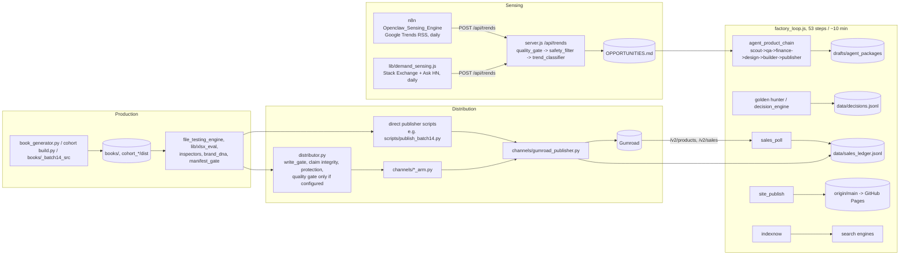

# Factory architecture map (as implemented, 2026-10-23)

This describes what the code does today, not the intended design. Layer letters follow the engineering mandate.

## Layers

| Layer | Real implementation | Notes |
|---|---|---|
| A. Strategy and policy | `CLAUDE.md`, `OpenClaw_Brain/00_Governance/` (constitution, `PERMANENT_OPERATING_DOCTRINE.md`), `.env` switches | Policy is written in many places; the doctrine check (`scripts/check_doctrine.py`) is the executable part. |
| B. Orchestration | `factory_loop.js` under `scripts/supervisor.js`; n8n for Sensing and Sales_Poll; `lib/agent_chain.js` for agent handoffs | One real scheduler (the loop). Daily gates use marker files or per-day task ids. No queue service; none is needed at current volume. |
| C. Research | `market_hunter.py`, `golden_hunter/`, `decision_engine/`, `profit_oracle.py` (Proof of Payment gate), `multi_source_intelligence/`, Sensing + demand sensing | Scoring is rich; real demand evidence is rare. Proof-of-payment rejects most niches, by design. |
| D. Product engineering | `book_generator.py` (PDF books), `cohort_GF_BATCH10/11/build.py` (guide + workbook + docx kits), `cohort_workbook.py`, `scripts/build_tool_workbook.py`, `books/_batch14_src/` (spreadsheet tools) | Several generators with overlapping roles; no shared product specification format. |
| E. Quality | `file_testing_engine.py`, `lib/xlsx_eval.py`, `inspectors.py`, `quality_gate_policy.py` (gate 1 evidence + gate 2 founder review), `manifest_gate`, `brand_dna.py`, `product_claim_integrity.py` | Strong pieces; applied unevenly. The central Quality Gate is consulted by `distributor.py` only when configured, and direct publisher scripts bypass it. |
| F. Catalog and distribution | `data/catalog.json` (platform-keyed), `reports/CYCLE104/DIGITAL_PRODUCT_INVENTORY.json` (21 products), `product_state_reconciliation.py`, batch manifests, `channels/` arms and publishers | Identity is the platform id; several inventories disagree (see gap register). |
| G. Measurement | `scripts/poll_sales.py` (n8n Sales_Poll), `channels/ledger.py`, `config/reality.json`, page-view and click ledgers, `connection_verifier.py`, `data/agent_executions.jsonl` | Measures correctly that there is nothing to measure yet: 0 sales, ~10 visits/month. |
| H. Reliability and security | `channels/write_gate.py`, `channels/write_scope.py`, `gumroad_auth_watch.py`, `scripts/scan_for_secrets.py`, CI (`.github/workflows/ci.yml`), `incident_memory.py`, supervisor | Mature for writes. Secrets only in `.env`. Public repository requires constant care about product files. |

## Trust boundaries

1. **External writes**: every mutation to Gumroad, Paddle, Etsy, X, IndexNow or messages passes `channels/write_gate.py`. Catalog writes need `FACTORY_LIVE_PUBLISH` (in-process) or a single-use scope; checkout, messages and search pings each have their own switch.
2. **Public repository**: everything committed is public through GitHub Pages and raw URLs. Product files must be git-ignored; `scripts/auto_publish_site.py` pushes only site-page-only ranges.
3. **Founder authority**: gate 2 of the Quality Gate and `data/founder_approvals.jsonl` are founder-owned; automation never writes them.
4. **Model calls**: Groq through `lib/agent_runtime.js` with telemetry; outputs validated against step contracts before use.

## Data stores that act as sources of truth

| Question | Authoritative source today |
|---|---|
| Is a product live? | Gumroad API (`GET /v2/products/:id`), not local files |
| Did anything sell? | Gumroad `/v2/sales` via `scripts/poll_sales.py` and `config/reality.json` |
| What did the factory build? | Batch manifests (`books/batch14/*/manifest.json`, cohort manifests) and `books/_generation_log.jsonl` |
| What is the release state? | `product_state_reconciliation.py` (one primary state + flags) for the 21 products it covers |
| What external writes happened? | `data/sales_ledger.jsonl` publish_attempt events |
