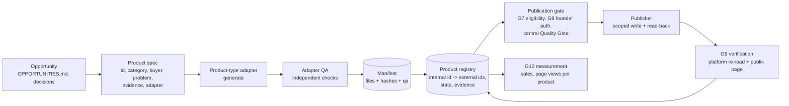

# Target architecture (staged)

Principle: smallest change that closes a demonstrated gap. No new orchestrator, database, queue or framework: `factory_loop.js` is the scheduler, JSON/JSONL files are the store, and the volume (tens of products, ~10 visits a month) does not justify more.

## Components and interfaces

| Component | Interface | Builds on |
|---|---|---|
| Product registry (`data/product_registry.json`) | one record per product: `internal_id` (stable, never reused), `family`, `category`, `external_ids` (gumroad, paddle, ...), `manifest`, `primary_state`, flags, `evidence` | `data/catalog.json`, batch manifests, `product_state_reconciliation.py` |
| Manifest contract | `{id, slug, title, price_cents, files: {role: {path, bytes, sha256}}, qa: {ok, checks...}}` | `books/batch14/*/manifest.json` (already this shape) |
| Product-type adapters | `build(spec) -> (artifacts, checks)`; `qa(artifacts, checks) -> report` | `books/_batch14_src/b14_core.py` (spreadsheet + PDF guide + cover + bundle) |
| Publication gate | single entry point for any listing write; runs eligibility, central Quality Gate, authorization record | `distributor.py`, `quality_gate_policy.py`, `channels/write_gate.py` |
| Publisher | scoped upload, create, read-back, cover, public-page check | `scripts/publish_batch14.py`, `channels/gumroad_publisher.py` |
| Drift check | registry vs live Gumroad vs manifests -> list of differences | `commercial_reconciliation.py` |

## Stages

1. **Identity (now).** Product registry with stable internal ids for every product the factory owns, mapped to live Gumroad ids; drift check runs in the loop daily and reports differences. No behaviour change elsewhere.
2. **Publication through one gate.** Direct publisher scripts call the same gate as `distributor.py`; gate 2 records stay founder-owned. Coordinate with the parallel session's uncommitted mandatory-gate test.
3. **Adapters.** Move cohort and book generators behind the manifest contract one at a time, starting with the generator of the thin PDFs (R5).
4. **Measurement per product.** Page views and clicks keyed by internal id; sales joined from `/v2/sales` by Gumroad id via the registry.

## Trade-offs

- JSON files instead of a database: simple, diffable, already used everywhere; concurrency is limited to one loop and occasional manual runs.
- Product sources stay out of the public repository; only manifests and covers are committed. Rebuilding a product therefore requires the factory machine.
- Not unifying the 293 Mission Control services now: the cost is maintenance, not correctness, and it does not move revenue.
