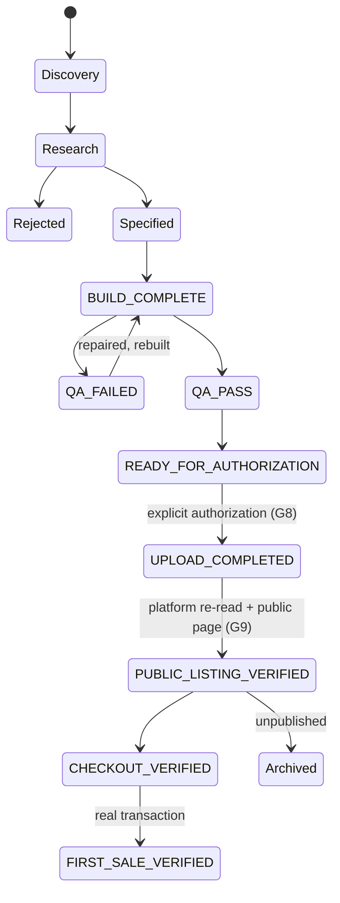

# Product lifecycle and authorization

The authoritative release states already exist in `OpenClaw_Brain/00_Governance/PERMANENT_OPERATING_DOCTRINE.md` and are implemented by `operational_history.py` and `product_state_reconciliation.py`. This document does not replace them; it adds the earlier stages, maps the mandate's names onto them, and states the transition rules.

## States

| Stage | Mandate name | Existing state | Proven by |
|---|---|---|---|
| Discovery | IDEA, RESEARCHING | `OPPORTUNITIES.md` entry; decision_engine record | trend/question passed quality, safety and commercial-intent gates |
| Research | RESEARCH_VALIDATED / REJECTED | decision_engine ACCEPTED / REJECTED / DEFERRED | `data/decisions.jsonl` with evidence snapshot |
| Specification | SPECIFIED | agent package (`drafts/agent_packages/*.json`) or product module (`books/_batch14_src/pNN_*.py`) | spec file exists, reviewed |
| Build | IN_PRODUCTION -> BUILD_COMPLETE | `BUILD_COMPLETE` | artifacts exist on disk |
| QA | QA_PENDING / QA_FAILED / QA_PASSED | `QA_PASS` | manifest `qa.ok` with checks that a separate engine performed |
| Packaging + listing | PACKAGED, LISTING_READY, AWAITING_AUTHORIZATION | `READY_FOR_AUTHORIZATION` | bundle hash recorded in manifest; listing copy passed brand checks |
| Upload | (write reached platform) | `UPLOAD_COMPLETED` | platform returned an id |
| Live | PUBLISHED_VERIFIED | `PUBLIC_LISTING_VERIFIED` | platform re-read says published + public page answers 200 with the title |
| Purchasable | | `CHECKOUT_VERIFIED` | a checkout path is live |
| Sold | | `FIRST_SALE_VERIFIED` | a real external transaction in `/v2/sales` |
| End | ARCHIVED / BLOCKED | (flags) | |

A product has exactly one primary state; publication, QA, authorization and purchasability are independent flags and are never summed (`product_state_reconciliation.assert_invariants`).

## Transition rules

1. QA_FAILED never becomes QA_PASS by relabelling: a rebuild must produce new artifacts and a new manifest.
2. `UPLOAD_COMPLETED` requires an explicit authorization for that product (G8). A previous approval does not carry over to other products.
3. `PUBLIC_LISTING_VERIFIED` requires platform evidence: `GET /v2/products/:id` shows `published: true`, price and name match, and the public URL answers 200 with the title. A local script reporting success is not enough.
4. Re-running a publication must not create a duplicate: `create_product` refuses an existing title, and the publish script refuses a bundle whose hash differs from the reviewed manifest.
5. Interrupted runs resume per product: a product with a recorded platform id is not created again.

## Authorization boundaries

| Action | Requires |
|---|---|
| Local research, generation, QA, packaging | nothing (autonomous) |
| Site pages that touch only `customer_site/`, `sitemap.xml` | tests pass; `scripts/auto_publish_site.py` (founder decision 2026-10-23) |
| IndexNow pings for published pages | `GF_ALLOW_SEARCH_PING` (founder decision 2026-10-23) |
| Creating, changing, unpublishing or deleting a Gumroad/Paddle/Etsy listing | explicit founder authorization naming the products; `FACTORY_LIVE_PUBLISH` set only in the publishing process |
| Checkout transactions | `GF_ALLOW_CHECKOUT_TRANSACTIONS` |
| Messages to third parties | `GF_ALLOW_OUTBOUND_MESSAGES` |
| Gate 2 founder review, `data/founder_approvals.jsonl` | the founder only |
| Pushing code (non-site) to `main` | reviewed push after a CI-equivalent run on a clean checkout |
| History rewrite / force push | explicit founder decision (not granted) |

## Known deviation

Batch 14 (2026-10-23) went `READY_FOR_AUTHORIZATION -> UPLOAD_COMPLETED -> PUBLIC_LISTING_VERIFIED` under the founder's explicit instruction, through `scripts/publish_batch14.py`, without the central Quality Gate in `distributor.py`; gate 2 records were not written on the founder's behalf. See `reports/BATCH14_PRODUCTS_2026-10-23.md` and risk R4.
